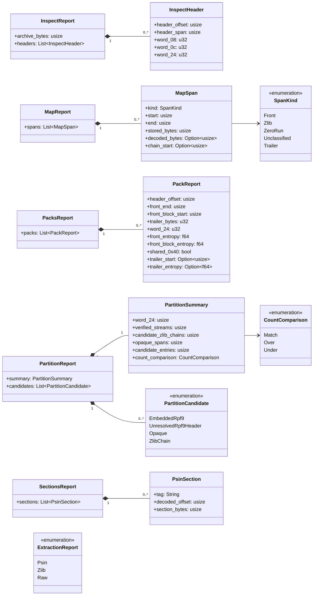
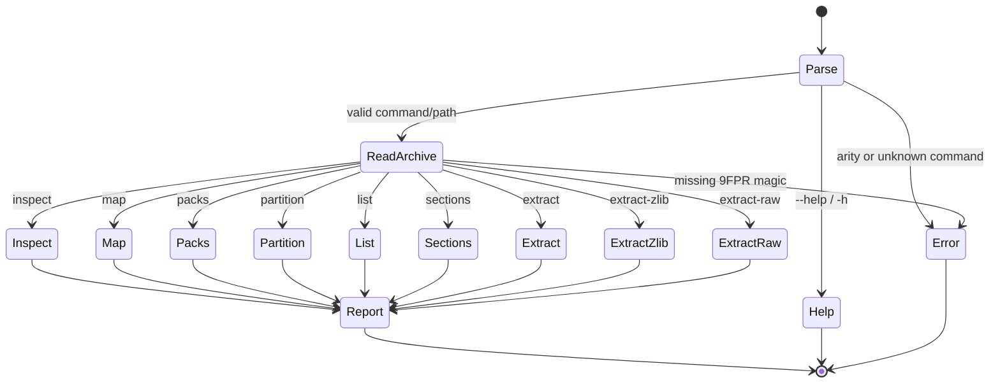
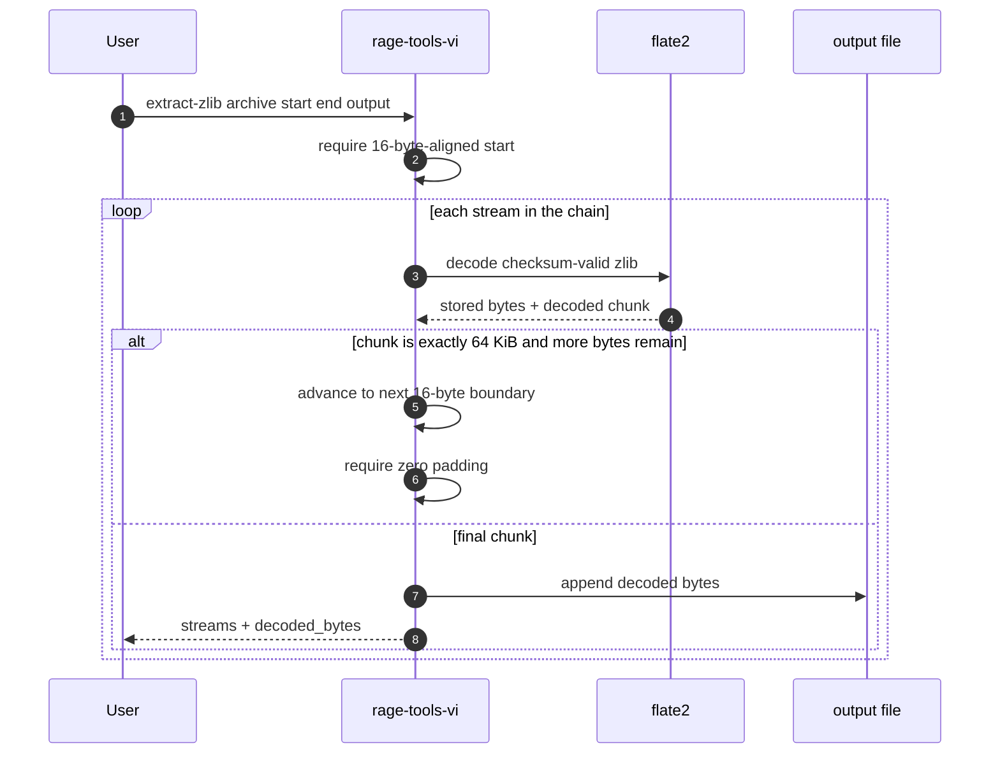

# Rust CLI and report model

The binary is intentionally small: it validates structure and emits typed
reports. It does not guess names or object semantics. The JSON contract is summarized in
[Report formats](../reference/report-formats.md); the canonical file is
`format.md` at the repository root.

## Commands

| Command | Scope | Main evidence |
| --- | --- | --- |
| `inspect` | page-aligned `9FPR` headers | header words |
| `map` | every byte in a pack range | front / zlib / zero / trailer spans |
| `packs` | nested packs | front entropy, trailer bounds |
| `partition` | candidate entries | chain/opaque count vs `+0x24` |
| `list` | PSIN zlib streams | decoded magic |
| `sections` | PSIN section walk | section tags and sizes |
| `extract` | PSIN payload | checksum + `CHKS` |
| `extract-zlib` | aligned stream chain | 64 KiB continuation rule |
| `extract-raw` | literal byte range | no interpretation |

## Report model

`MapSpan.decoded_bytes` and `chain_start` are present only for `Zlib`.
`PackReport.trailer_start` and `trailer_entropy` are present only for the
selected pack at relative offset zero with a nonzero trailer. In JSON the
tagged enums use `kind`, `candidate`, `mode`, and `count_comparison` as
discriminators.

## Command dispatch

## Aligned zlib extraction

!!! note "Design boundary"
    `extract-zlib` validates framing and checksums. It deliberately does not
    interpret `PSIN`, `LSCH`, `LSNS`, or any object record.
