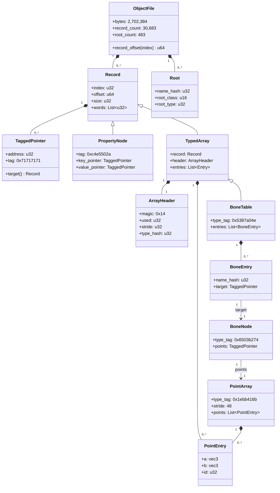
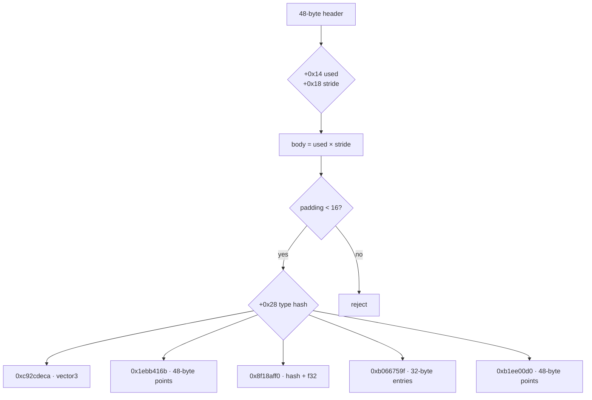
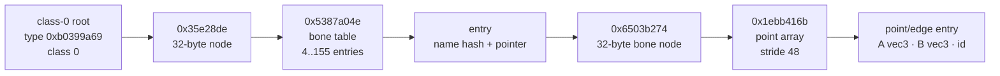
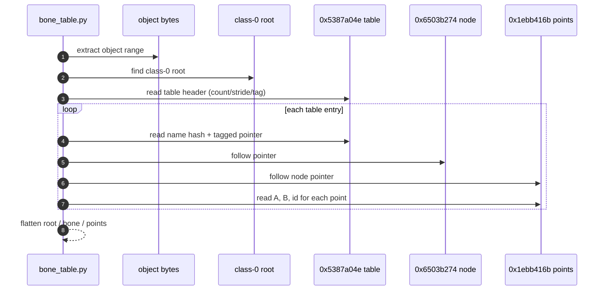
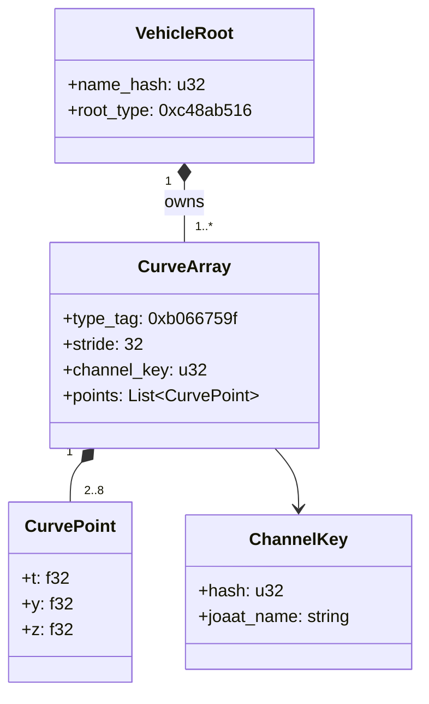
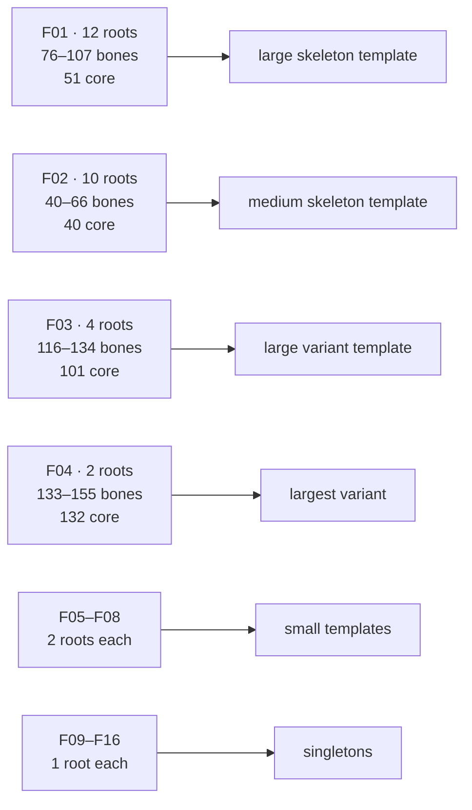
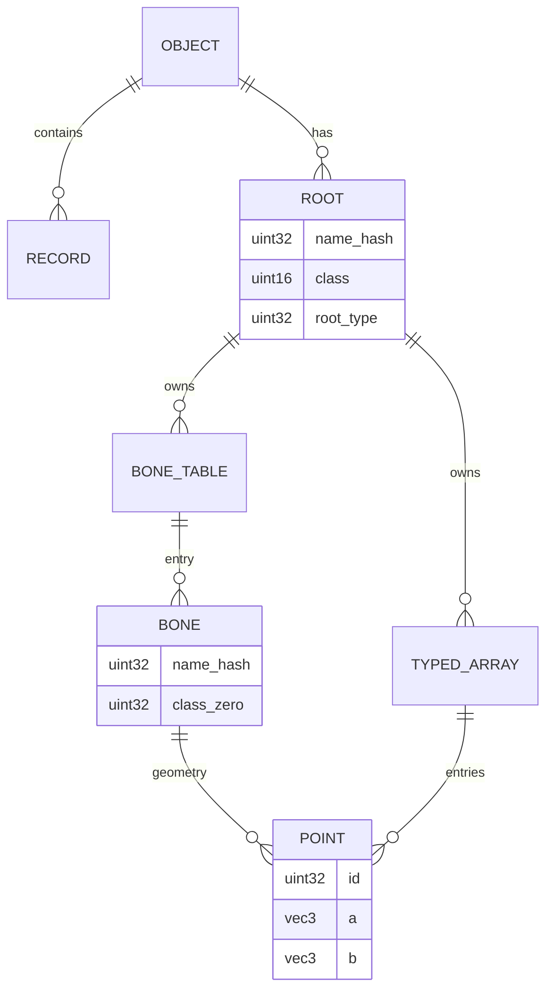

# Object graph

The `script.rpf@0x1000` entry decodes to a 2,702,384-byte object with 30,683
records, 483 roots, and 30,200 tagged references. This page models the graph
and the two array families that have been decoded so far.

## Record and pointer model

## Root classes

The `+0x04` word is `[u16 zero][u16 class]`.

| Class | Roots | Shape | Note |
| ---: | ---: | --- | --- |
| `0xffff` | 385 | one pointer, vehicle-like | named vehicle family |
| `0` | 86 | one pointer | contains the 44 skeleton roots |
| `1`, `2`, `3`, `5`, `6`, `8` | 12 total | one pointer | type-`0xd72178e2` family; split not yet resolved |

## Typed array header

All value arrays use a 48-byte header:

| Offset | Field | Evidence |
| ---: | --- | --- |
| `+0x08` | constant `0x14` | observed arrays |
| `+0x14` | used count | matches entries |
| `+0x18` | stride | 4, 8, 12, 16, 32, 48 |
| `+0x28` | element type hash | `0xc92cdeca = vector3` |

The body is `count × stride`; fewer than 16 bytes of zero alignment padding may
follow. The complete inventory finds **7,960 arrays**, including zero-count
arrays whose stride exceeds the empty body.

| Type tag | Stride | Arrays | Entries | Meaning |
| --- | ---: | ---: | ---: | --- |
| `0x1ebb416b` | 48 | 3,043 | 15,732 | class-0 bone points/edges |
| `0x8f18aff0` | 8 | 2,491 | 7,630 | normalized weights; every array sums to 1.0 |
| `0xb066759f` | 32 | 1,935 | 4,365 | eight-word entries |
| `0xb1ee00d0` | 48 | 186 | 294 | vec3 at `+0x10` + id; 4 class-0 roots |
| `0xc92cdeca` | 16 | 82 | 2,605 | `vector3` |
| `0x0000000f` | 4 | 93 | 1,646 | single floats |
| `0x2ff4ac04` | 12 | 4 | 6 | three packed floats |

## Class-0 skeleton hierarchy

**44 tables**, **3,043 entries**, **3,043 point arrays**. Table hashes: **612
unique**, shared across roots. Point ids are `[high:8][index:8]`, index `0..49`,
high byte `0/1/2`.

## Traversal sequence

## Vehicle mover curves

The `0xb066759f` arrays are curves under named vehicle roots, not generic
geometry. They decode 1,935 curves across 244 vehicle roots and 36 channels.
The vehicle-like root inventory is **385 roots: 306 named, 244 with curves,
141 without**. `handoff/script-vehicles.tsv` is the join table.

| Key | Name | Curves | Roots |
| --- | --- | ---: | ---: |
| `0x86d36840` | `window_lf_mover` | 319 | 174 |
| `0x031fd5fc` | `window_rf_mover` | 317 | 173 |
| `0x6ec686bf` | `window_lr_mover` | 148 | 83 |
| `0xfc0ce3f6` | `window_rr_mover` | 148 | 83 |
| `0xe179bcee` | `door_dside_r` | 2 | 2 |
| `0x41628d75` | `door_pside_r` | 2 | 2 |

Four unnamed channels (`0xfbdba1a6`, `0xeaeecb7b`, `0x8bb5d91e`, `0x552ea55`)
occur in roughly 200 roots each:

The y/z units are **unresolved**. The native-precision grid test matches a
random-offset baseline at 1.0°, 0.5°, and 0.25°, so the earlier degree
quantization claim is retracted. Same-root leaf matches (727/6,539 = 0.1112)
do not beat the seeded cross-root permutation (mean 0.1151, p95 0.1191). The
positional bonnet/boot interpretation is also withdrawn. The four unnamed
channels are parked until a decoded schema or named mover link exists.

`handoff/script-vehicle-curves.tsv` has one row per curve with root name, key
hash/name, point count, and t/y/z ranges.

The first same-root name/part join is negative: 0/1,935 curves match a named
part or a non-key-node name in the same vehicle root, including the known
positive controls. `handoff/script-vehicle-curve-join.tsv` records the result
and the rotation-leaf count. Angular quantization is strong; leaf identity is
not.

Branch calibration on `astron` separates the two window curves: the outer
branch carries the large travel and the inner branch has a left/right sign
split. The four unnamed channels form two persistent pairs; on `216cstreamer`
each pair is equal, while on `airbus` the pair members have opposite signs.
This is a symmetric four-mover pattern; the units and names remain open.
`handoff/script-vehicle-branch-relations.tsv` has the endpoints.

## Skeleton template families

Exact bone-hash sets give 38 groups, but the roots instantiate a much smaller
catalogue. At Jaccard >= 0.75 the 44 roots collapse into **16 families**.

| Family | Roots | Bones/root | Core | Union | Avg bbox | Hint |
| --- | ---: | ---: | ---: | ---: | --- | --- |
| F01 | 12 | 76–107 | 51 | 112 | 1.08 × 0.74 × 1.22 | medium |
| F02 | 10 | 40–66 | 40 | 66 | 0.44 × 0.20 × 0.95 | weapon-like |
| F03 | 4 | 116–134 | 101 | 155 | 3.00 × 2.43 × 2.57 | vehicle-like |
| F04 | 2 | 133–155 | 132 | 156 | 1.85 × 1.97 × 3.46 | vehicle-like |
| F05 | 2 | 67–71 | 65 | 73 | 1.14 × 1.45 × 1.53 | unresolved |
| F06 | 2 | 31–34 | 30 | 35 | 1.04 × 1.07 × 1.16 | unresolved |
| F07 | 2 | 22–24 | 22 | 24 | 0.31 × 0.18 × 0.71 | small |
| F08 | 2 | 4 | 4 | 4 | 0.00 × 0.51 × 0.01 | flat |
| F09–F16 | 1 each | 2–133 | all | all | varies | mixed |

Shape hints are not names. F02 being narrow and long is a weapon-like candidate;
F03/F04 being large is vehicle/trailer-like. F01 remains unresolved.

The core hashes are stable; the variable hashes are optional bones or variants.
Artifacts: `script-bone-geometry.tsv`, `script-bone-templates.tsv`, and
`script-bone-template-families.tsv`.

**Data-side negative:** 0 of 44 roots and 0 of 612 bone hashes match JOAAT of
2,502 pointed resource names/stems or 3,212 PSIN names. A verified mapping needs
an independently decoded ordered skeleton.

## Two families

The skeleton family (`0xb0399a69`, class 0) is distinct from the
type-`0xd72178e2` family that owns the `vector3` and `(hash, f32)` arrays.
Do not merge the two while naming fields.

!!! abstract "Handoff"
    `handoff/script-bones.tsv` has 3,043 bone rows and
    `handoff/script-bone-points.tsv` has 15,732 point/edge rows.
