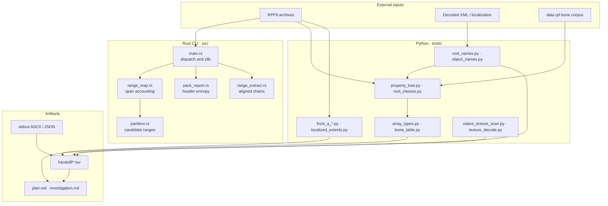
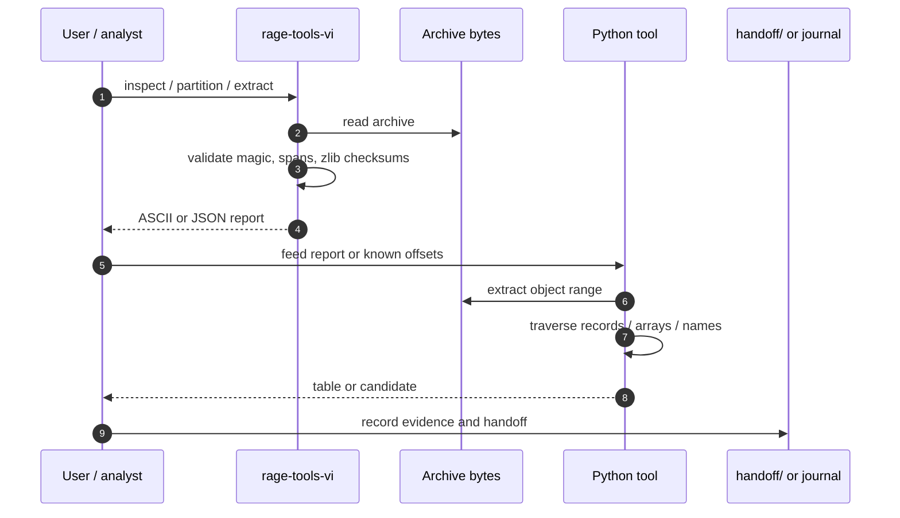
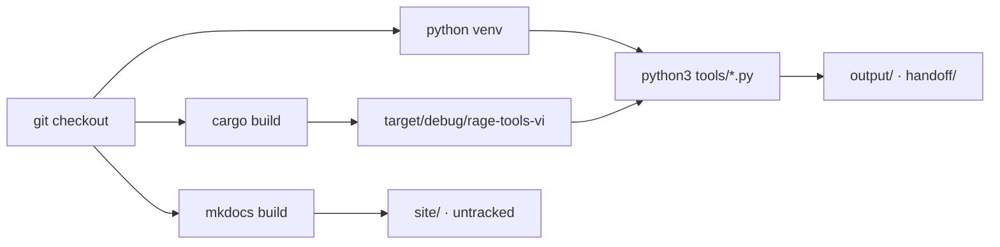

# Architecture overview

The project has four layers: **byte access**, **reporting**, **object-graph
analysis**, and **corpus-specific extraction**. The Rust CLI owns byte access
and checksum validation; Python tools own naming, graph traversal, and
experiments; the handoff and journals are the integration surface.

## Component view

## Runtime sequence

## Module responsibilities

| Module | Owns | Does not own |
| --- | --- | --- |
| `src/main.rs` | CLI dispatch, zlib decode, top-level reports | object semantics |
| `src/range_map.rs` | byte partitioning, chain starts | archive index meaning |
| `src/partition.rs` | candidate entries vs `+0x24` | directory-node proof |
| `src/pack_report.rs` | header words, entropy, trailer bounds | trailer record meaning |
| `src/range_extract.rs` | 16-byte aligned zlib continuation | payload semantics |
| `tools/*.py` | names, records, arrays, experiments | canonical byte extraction |
| `handoff/` | exchanged tables | source of truth for the format |

## Deployment and reproducibility

!!! warning "Samples are local"
    The `*.rpf` files are large and untracked. Documentation diagrams describe
    their structure, not a distributable corpus.
