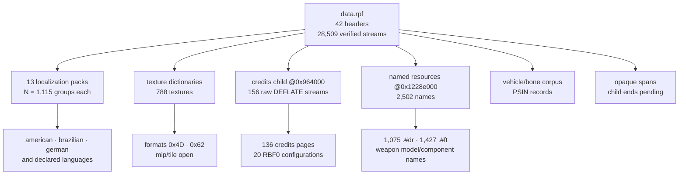
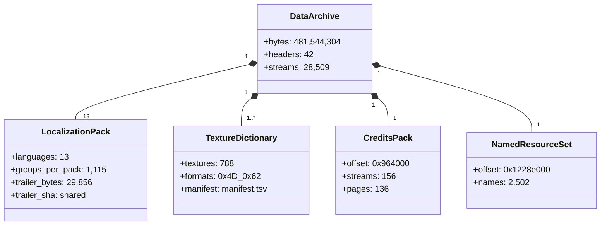
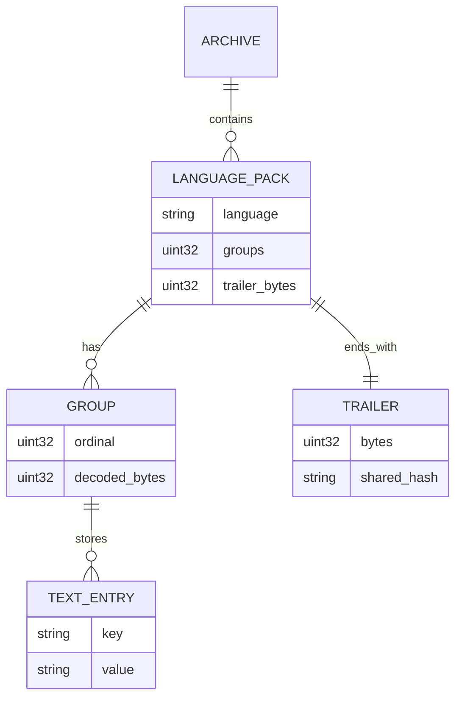
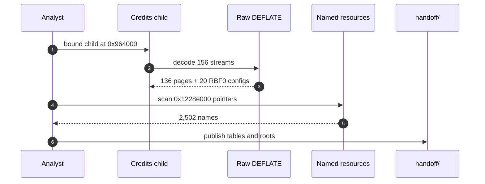

# data.rpf

`data.rpf` is the large corpus: localization, textures, credits, metadata, and
named resources. It is the primary place to borrow names and layouts for the
script object.

## Corpus map

## Stream accounting

| Metric | Value | State |
| --- | ---: | --- |
| top-level archives | 6 | inventory |
| checksum streams | 30,527 | verified |
| `data.rpf` streams | 28,509 | verified |
| plausible headers | 42 | candidate |
| carved child packs | 40 | candidate |
| default PSIN chains | 2,281 | 2,256 complete |
| decoded RBF0 chains | 1,260 | readable roots |
| texture dictionaries | 73 | valid |
| textures | 788 | descriptor-valid |

## UML view

## Localization ER

## Credits and named resources

## Skeleton-family negative

The 16 class-0 skeleton families do not match the pointed resource-name corpus
or the harvested PSIN names: 0/44 roots and 0/612 bone hashes. A model/layout
mapping needs an independently decoded ordered skeleton.

## Open boundaries

The final child end at `0x1a279000` and opaque streams near `0x120d7000`
remain open. The 13 localization packs share identical 29,856-byte trailers,
which is a cohort observation, not yet a cross-archive law.
