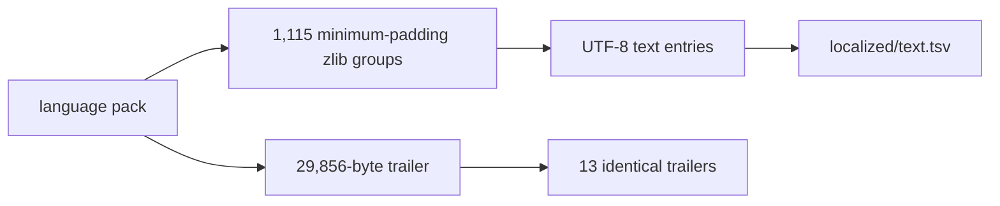
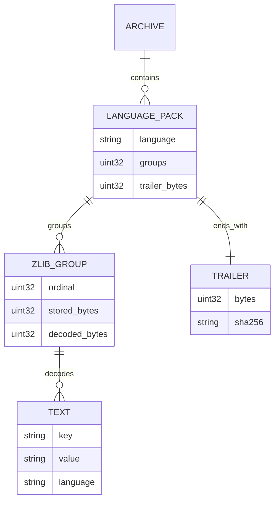
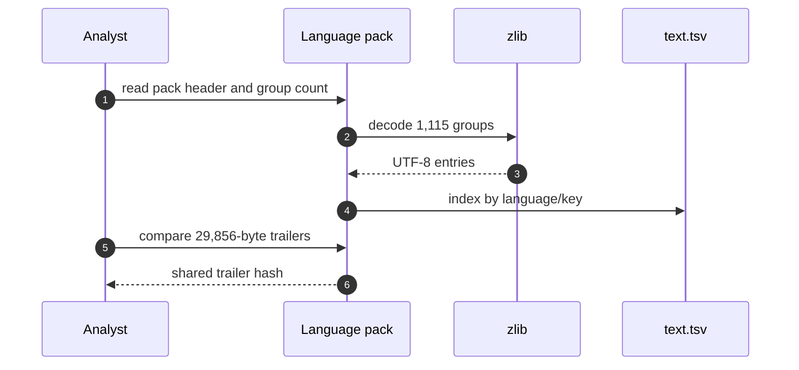
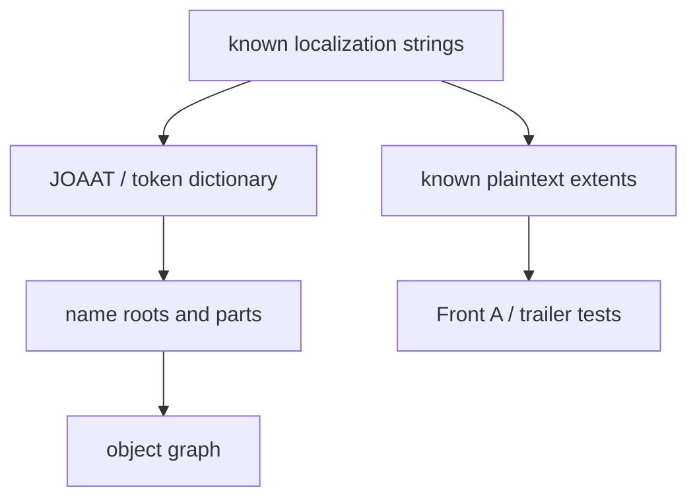

# Localization

Localization is the most complete plaintext corpus in the archive. It gives
known strings, language order, and group boundaries that can be used as cribs
for otherwise opaque metadata.

## Pack structure

## Entity model

## Language order

The localization payloads identify every language in the order declared by
`core_language`. The observed set includes `american`, `brazilian`, and
`german`; the shared trailer makes the packs a cohort.

## Crib value

## Open questions

- Is the shared trailer a deterministic build-wide value or a localization
  table?
- Can the group ordinals predict any Front A field?
- Does the language order break the `N mod 4 = 0` metadata ambiguity?
