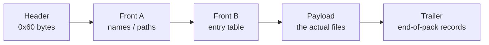
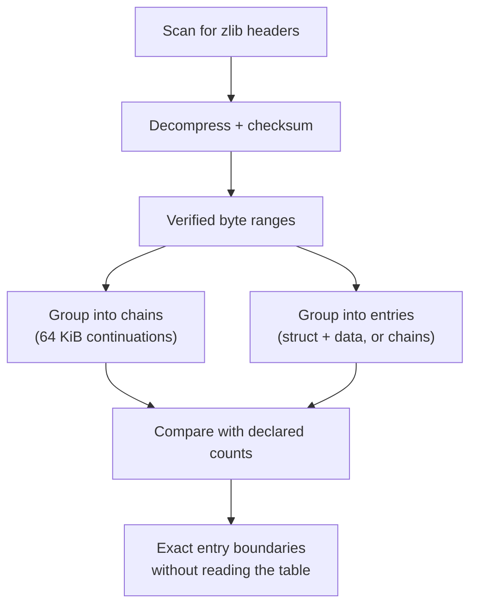
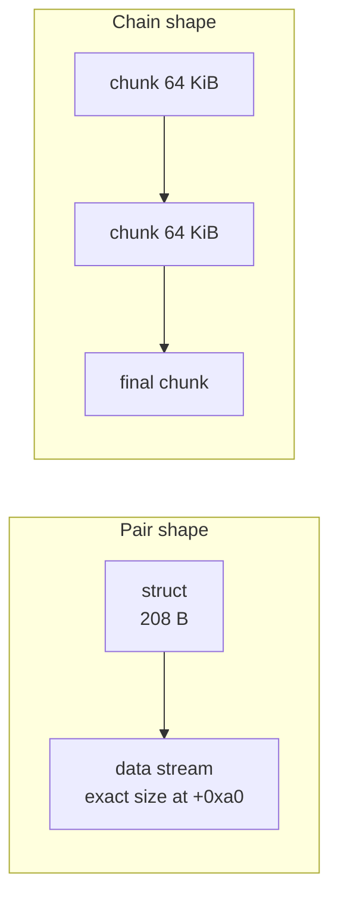
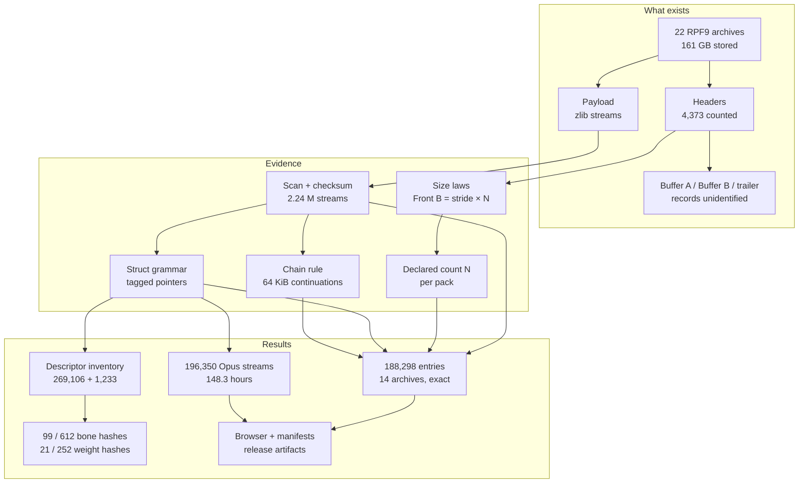

# From first principles

This page builds the method up from nothing: what the data is, what can be
observe, and how each observation leads to the next. No prior knowledge of the
game or the format is assumed. Terms are defined the first time they appear.

## 0. The problem

A game ships its data inside a few very large archive files (`.rpf`). To mod,
audit, or study the game you need to know **what is inside them**: the entries,
their names, where their bytes live, and how those bytes are encoded.

Our goal, stated precisely:

> Enumerate every archive entry, locate its stored bytes, and extract it with the
> correct decoding.

The archives are binary and undocumented. There is no header comment that says
"this is the table of contents and here is its entry format". So everything below
is *inference from bytes*, and every claim has to be checkable.

## 1. What an archive is

An RPF9 archive is a **container**: a header, three metadata regions, a payload
area, and a trailer.

| Region | Purpose | Readable |
| --- | --- | --- |
| Header | sizes and pointers for the rest | **yes** — every field is now code-confirmed |
| Buffer A | header, four sections, then one record per entry | the *layout* yes; the section contents are unidentified |
| Buffer B | one fixed-stride record per entry | the size law yes (`align16(N × stride)`); the records are unidentified |
| Payload | files, mostly zlib-compressed | **yes**, and verifiable |
| Trailer | per-pack records | no |

The bytes of the two metadata buffers look uniformly random, and no 32-bit or
64-bit hash of any known name appears in them. The executable's loader **copies
them verbatim** — so if a transform exists it lives in the stream's `Read`, not in
the archive layer. That nuance matters less than the practical consequence, which
has not changed: **contents are reconstructed from the payload, and the
metadata only as a cross-check.**

## 2. What can be trusted: checksums

The payload is mostly **zlib streams**: a compressed block that begins with a
recognisable header and ends with a checksum (Adler-32) of the decompressed data.

That gives something rare in reverse engineering, a **self-verifying signal**: if
a candidate range decompresses and its checksum matches, that range is almost
certainly a real stored file chunk. Scanning for these ranges produced
**2,241,410 streams** across the corpus, every one checksum-verified.

From there the reasoning chain is:

The scan tells us *where* the bytes are. It does not tell us which file is which,
or what the file means. Those are separate problems, solved separately.

## 3. What the unreadable metadata still tells us

Even unreadable bytes leak **sizes**. Three size laws fell out of a census of
4,373 headers:

- the trailer length is stored in the header and always matches the trailing
  region (`+0x0c`);
- Front B — the entry table — is exactly `align16(stride · N)` where `N` is the
  declared entry count, for all 2,908 headers of the dominant mode family;
- the stride is `9` bytes for one format tag and `10` for another, and the tag is
  chosen by the count itself (small packs vs large packs).

The table's *contents* are unreadable, but its *shape* is known, and — crucially —
so is **how many entries each pack declares**. That number becomes the yard
stick for the payload work: if a payload reconstruction produces exactly `N`
entries, the reconstruction is very likely right.

This is the key methodological move of the project:

> **Use the unreadable table as an oracle for counting, and the payload for
> structure.**

## 4. Reconstructing entries from the payload

Payloads come in two self-describing shapes, and each archive uses one:

**Pairs.** A small stream — a *struct* — immediately followed by its data stream.
The struct is a little record of fields: tagged pointers, an orientation basis,
two identifiers, and the **exact size of the data that follows**. In
`core_bvh4` the struct is 208 bytes and this pairing holds for 3,967 of 4,000
sampled entries.

**Chains.** A large file is stored as 64 KiB chunks; a chunk continues its
predecessor when the predecessor decoded exactly 65,536 bytes and the next stream
starts on the 16-byte boundary after it. One chain = one entry. `data` and
`navmeshes` use this shape.

Because the struct declares the data size, the pair shape is **exact**: the
descriptor predicts a byte range, the range decompresses, and every byte past the
declared size is zero (verified on re-decoded samples). That is the project's
first milestone: *one decoded record independently predicts a checksum-verified
byte range*.

## 5. From numbers to names

Every identifier in the *object graph, bone tables and weight arrays* is
**JOAAT**, the one-at-a-time hash: a specific 32-bit function of a string.

That scope matters. Archive **entry names** are not JOAAT: the executable hashes them
with **Murmur3 x64-128** over `tolower(name)` with `\\` folded to `/`, and then
resolves them through a 16-bit id taken from a runtime dictionary
([the executable](reference/executable.md)). So JOAAT is the hash of *content* names,
not of *file* names.

That turns "opaque number" into "guess the string, test the hash". With a
vocabulary of rig concepts resolved **99 of 612** bone-table hashes and **21 of
252** weight hashes. The names came out in three families:

| Prefix | Meaning | Example |
| --- | --- | --- |
| `skel_` | skeleton bone | `skel_l_calf` |
| `mh_` | muscle helper | `mh_l_bicep` |
| `rb_` | ragdoll body | `rb_l_shoulder01` |

One rig is now fully decoded: 34 bones, symmetric left/right blocks with a
constant index offset — a hand/forearm rig with four three-segment finger chains.

## 6. The media layer

Some payloads are not game data at all. The large "unclassified" spans turned out
to be **media containers**:

| Container | Signature | Content |
| --- | --- | --- |
| AWC | `ADAT` | game audio (Opus, XMA2, ACE1 impulse responses) |
| Bink / Bink2 | `BIK`, `KB2n` | video |

Two AWC layout families were decoded and one of them, in `story000`, produced
**196,350 Opus streams / 148.3 hours of audio**. That is why the "unknown bytes"
figure collapsed from 52.8 GB to essentially zero: it was audio and video, not
unnamed assets.

## 7. The concept map

Everything above, in one picture. Arrows mean "is evidence for" or "unlocks".

## 8. What is still open, and why

Not everything is solved. The honest boundary:

- **Metadata record contents.** The loader copies both metadata buffers verbatim and
  the layout is code-derived, so the container is understood — but what the records
  *mean* is not. No 32-bit or 64-bit hash of any known name appears in them, and the
  archive's own name hash is Murmur3 x64-128 whose 16-bit id comes from a runtime
  dictionary whose source has not been located. Naming those records is the open problem,
  and it is *information*-blocked, not effort-blocked.
- **Names.** 330 bone hashes belong to a namespace whose vocabulary has not been
  found — small props and weapons, not anatomy.
- **Mixed packs.** Packs whose entries mix both shapes cannot be counted exactly;
  the manifests mark them rather than guessing.

Everything else in this site is built on the chain above: checksums give ranges,
sizes give counts, structures give entries, hashes give names.

## 9. Where to read next

| If you want… | Read |
| --- | --- |
| the short list of results | [Findings](findings.md) |
| the byte-level format | [RPF9 format](rpf9/format.md) |
| the metadata regions in detail | [Metadata regions](rpf9/metadata.md) |
| how entries were reconstructed | [Entry manifests](extraction/entries.md) |
| the rig naming work | [Rig names](data/rig-names.md) |
| the audio pipeline | [Audio](extraction/audio.md) |
