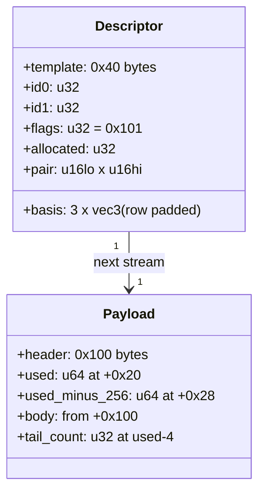

# BVH4 entries (`core_bvh4`)

`core_bvh4.rpf` stores its entries as a **contiguous pair of zlib streams**: a
208-byte descriptor followed by one data stream. Over a 4,000-entry sample the
stream after a descriptor is that entry's data and the stream after the data is
the next descriptor in **3,967 / 4,000** cases.

This makes `core_bvh4` the first archive where entry boundaries are recoverable
from the payload alone. The generated manifest `handoff/core-bvh4-entries.tsv`
lists **296,490 entries** over 1,282 packs:

| Shape | Entries |
| --- | ---: |
| `pair` (descriptor + data) | 269,106 |
| `struct` (small struct, plus any following > 64 KiB streams) | 25,507 |
| `orphan` | 1 |

**1,253 of 1,261 packs** have an entry count exactly equal to their declared N.
The residual is ±1 in 41 packs, ±2–5 in 12, and one outlier: the root pack,
whose 1,286 "entries" are the nested packs rather than streams — an independent
confirmation that a pack's declared count includes its child packs.

## Descriptor (208 bytes, 13 × 16)

| Offsets | Content | Evidence |
| --- | --- | --- |
| `+0x00..+0x3F` | constant template: eight `u32` slots, six of them `0x5`/`0x6`-tagged self-relative pointers | offsets land inside the record; the 256-byte header-only variant uses `0xb0`…`0xf0` |
| `+0x40`, `+0x44` | two per-entry 32-bit ids | 3,811 distinct of 4,000 |
| `+0x50..+0x7F` | right-handed orthonormal 3×3 basis, rows at `+0x50`, `+0x60`, `+0x70`, each padded to 16 bytes | orthonormal 4,000/4,000, det > 0, worst error 4.2e-05 |
| `+0x80`, `+0x84` | zero | constant |
| `+0x88` | `0x00000101` | constant |
| `+0x90..+0x9F` | zero | constant |
| `+0xa0` | allocated payload size, multiple of 256 | zero-padded tail verified on 260 samples |
| `+0xa4` | two `u16`: low multiple of 64, high multiple of 256 | both bounded by the allocated size; `(lo - 0x100) % 64 == 0`; reads as offsets, role open |
| `+0xa8..+0xCF` | zero | constant |



## The template is a struct, not a record type

The same template appears in descriptor-less entries, which are the small
header-only streams found where a pack's descriptor count falls short of its
declared N (27,373 streams, median 272 bytes). Their `+0x00..+0x3F` slots hold
the same eight values, but the tagged pointers move to `0xb0`, `0xd0`, `0xe0`,
`0xf0` and the `+0x10` count becomes 2. So the 208-byte descriptor and those
256-byte records are the **same serialized struct at different sizes**, with
self-relative `0x5`-tagged pointers and one `0x6`-tagged field. Within a size
class the header is byte-identical.

The struct is an `{ptr, u16 count, u16 capacity}` container family: the pairs
`0x00010001` (1/1) in the 160-byte record and `0x00040004` (4/4) in the 272-byte
record are count/capacity. The 272-byte record holds an array of four element
pointers at `0xc0`, each element a 32-byte record with an 8-byte hash at `+0x10`.

## Payload

- `+0x00..+0x1F` and `+0x30..+0xFF` are zero; the body starts at `+0x100`.
- `+0x20` is the **used** size: it equals `last_non_zero_byte + 3` in 160/160
  sampled payloads and is always a multiple of 4.
- `+0x28 = +0x20 − 256` in 160/160.
- The descriptor's `+0xa0` is the used size rounded up to a multiple of 64
  (gaps 0, 64, 128, 192), and a multiple of 256.
- The last four bytes before the used end are a **small little-endian `u32`**
  (1…15 observed, all ≤ 255), followed by three zero bytes. It grows
  monotonically with payload size and is count-like; a `log2` size class is
  falsified (48 %).
- Body data is sparse (~8 % non-zero), with 64-byte records, `0x81`-filled
  regions of exactly 2,048 bytes (32 nodes) at 64-byte boundaries, and a value
  table packed at a **3-byte stride**.

## What is ruled out

- `0x81` is not a fixed-lane `-127` sentinel: it occupies every offset of the
  64-byte frame about equally (5,760–5,955 per offset, 25 % below offset 16,
  the uniform share). It does appear as whole-node fills at 64-byte boundaries.
- The two ids are not JOAAT/CRC32 of the 3,524-name bone corpus or 1,087 local
  path tokens, not CRC32/JOAAT of the payload or stored bytes, and do not appear
  inside the payload.
- `+0xa4` is not a *span* pair (`hi < lo` in 3 of 16, and `(used - hi) % 3` is
  uniform so it is not the tail index table) and not a node count (`lo/64` = 144
  against 16,273 non-zero 64-byte records in one sample). It is bounded like an
  offset pair: `lo` and `hi` are both ≤ the allocated size, and in the decoded
  768-byte entry `lo` is exactly `0x100` (body start) and `hi` exactly `0x200`.

## Reproduce

```sh
python3 tools/bvh4_descriptor_probe.py --checks --verify-padding 60
python3 tools/bvh4_payload_probe.py --count 40
python3 tools/bvh4_node_probe.py --count 160
python3 tools/bvh4_struct_probe.py --samples 4
python3 tools/bvh4_entry_manifest.py
```
