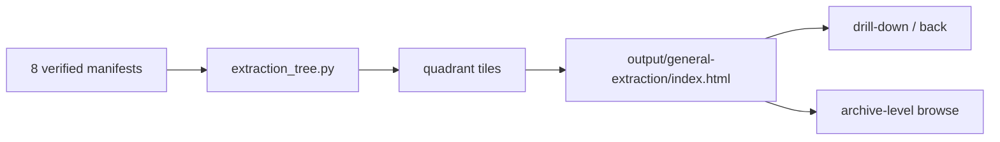

# Archive containment view

The containment viewer is the archive-level spatial browser introduced in
`4dc3f05`. It uses the same eight verified manifests as the inventory and turns
each archive into quadrant tiles.

## View contract



- coverage: 8 local archives, 86,029 ranges;
- navigation check: 36,640 emitted files, drill-down and back;
- pack tiles are shown where bounded inference completed;
- `data.rpf` and `textures.rpf` remain browseable at archive level;
- translation is deferred.

```bash
python3 tools/extraction_tree.py
# output/general-extraction/index.html
```

!!! note "Scope"
    `tools/extraction_tree.py` builds the containment view from the inventory
    and the entry triage. The separate bone-geometry quadtree is emitted by its
    own tool and is not part of this view.
