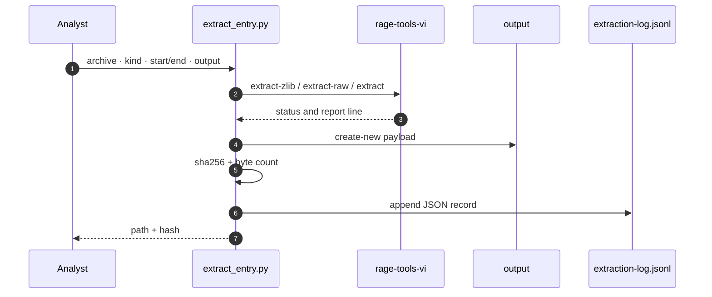
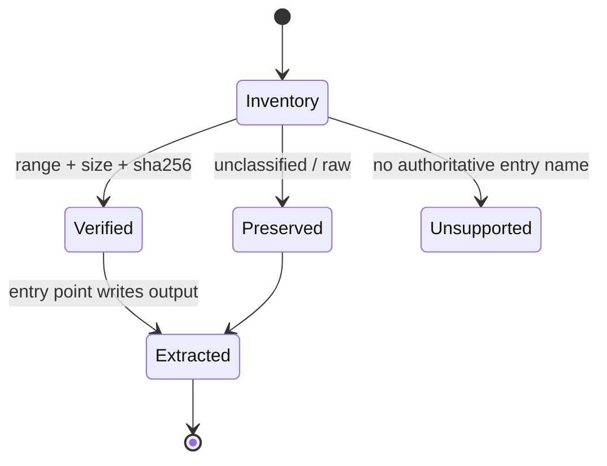

# Extraction inventory and entry point

Extraction-first baseline: every known stored byte gets a normalized inventory
row, and a single entry point invokes the Rust extractor with a create-new
output and hash log.

## Coverage baseline

All eight local archives now have complete contiguous range coverage.

| Archive | File bytes | Ranges | Mapped bytes | Decoded bytes | Unclassified | Status |
| --- | ---: | ---: | ---: | ---: | ---: | --- |
| `data.rpf` | 481,544,304 | 57,651 | 481,544,304 | 1,403,250,069 | 19,130,746 | full |
| `common.rpf` | 6,642,192 | 2,077 | 6,642,192 | 50,231,123 | 210,272 | full |
| `script.rpf` | 4,358,960 | 2,006 | 4,358,960 | 6,180,256 | 431,696 | full |
| `story000_bvh4.rpf` | 5,632 | 10 | 5,632 | 16,677 | 0 | full |
| `appdata0.rpf` | 8,880 | 5 | 8,880 | 0 | 5,216 | full |
| `core_licenses_data.rpf` | 13,536 | 13 | 13,536 | 2,004 | 4,976 | full |
| `shaders.rpf` | 411,695,600 | 18,686 | 411,695,600 | 275,540,780 | 273,959,915 | full |
| `textures.rpf` | 192,585,024 | 5,581 | 192,585,024 | 161,086,752 | 136,021,963 | full |

## How much is actually classified

A tidy index is not the same as an understood one. `tools/index_coverage.py` reports,
per archive, the share of bytes assigned a known kind — merging side indexes such as
`audio-adat.tsv` when a specialised pass exists:

| archive | size | main index | with side indexes |
| --- | ---: | ---: | ---: |
| `audio` | 28.5 GB | 0.07 % | **99.75 %** |
| `levels` | 76.2 GB | 99.65 % | 99.65 % |
| `data` | 0.48 GB | 95.80 % | 95.80 % |
| `textures` | 0.19 GB | 99.53 % | 99.53 % |
| `shaders` | 0.41 GB | 33.41 % | 33.41 % |
| `shared_minigame000` | 0.81 GB | 55.33 % | 55.33 % |
| `story000` | 20.0 GB | 35.39 % | **81.40 %** |
| `story000_script` | 0.08 GB | 32.04 % | 32.04 % |
| `core_restofworld` | 1.30 GB | 4.17 % | **99.98 %** |
| `movies` | 8.83 GB | 0.00 % | **99.99 %** |

Every index tiles its archive (union coverage 100 %), but the *classification* is
what tells you whether the bytes are understood. `movies` was the clearest case — 100 %
tiled and fully opaque — until `tools/bink_index.py` validated 515 Bink2 containers
covering **99.993 %** of its 8.8 GB (425,440 frames, 1,030 false `KB2` candidates
rejected by the width/height/fps check).

Repo-wide totals from the 22-archive index: **4,415,868 ranges**,
**161,307,137,472 stored bytes**, **365,020,088,082 decoded bytes**, of which
**2,241,410 are zlib ranges** and **2,190,635** have an extraction manifest.
`full` means every stored byte has a span; it does not mean every record has an
authoritative name or decoded semantics. The eight-archive table above is kept
for history; the corpus-wide figures supersede it.

## Entry point

```bash
python3 tools/extract_entry.py \
  --archive data.rpf --kind zlib \
  --start 0x12330 --end 0x12548 \
  --output /tmp/data-zlib.bin
```



Verified end-to-end (6/6 PASS). Note on the `script.rpf` blob below: its 331,728
bytes are verified by hash, but the size matches neither an indexed range nor a single
decoded stream in the current index, so its origin is not re-derivable from these
tables — it is a recorded artifact, not a located one.

- `script.rpf` object: 2,702,384 bytes, `592afd44…`;
- `script.rpf` blob: 331,728 bytes, `b5d622ca…`;
- `data.rpf` zlib `0x12330..0x12548`: 1,288 bytes, `7e341292…`;
- `data.rpf` unclassified raw `0x12000..0x12330`: 816 bytes, `1133e8d0…`;
- `common.rpf` zlib `0xb000..0xba08`: 65,536 bytes, `15c3a3f5…`;
- `story000_bvh4.rpf` zlib `0x340..0x4f1`: 800 bytes, `e20f1cc6…`.

Reproduce with `python3 tools/verify_extraction.py`.

## Unclassified gaps

The range layer is complete. Across the full corpus the unclassified layer is
**52,776,009,304 bytes in 26,759 spans**, and it is media, not unnamed game data:

| Source | Bytes | Content |
| --- | ---: | --- |
| `audio.rpf` | 28.5 GB | AWC audio, decoded |
| `story000` | 9.56 GB | AWC audio, decoded (148.3 h) |
| `movies.rpf` | 8.8 GB | Bink video |
| `story000` | 3.33 GB | Bink video |
| `core_restofworld` | 1.24 GB | Bink2 video |
| remainder | ~1.2 GB | fragments |

The table below is the earlier eight-archive view and is retained as history.

| Archive | Gaps | Bytes | Largest span |
| --- | ---: | ---: | ---: |
| `shaders.rpf` | 5,253 | 273,959,915 | 1,483,917 |
| `textures.rpf` | 59 | 136,021,963 | 27,997,847 |
| `data.rpf` | 673 | 19,130,746 | 1,131,248 |
| `script.rpf` | 5 | 431,696 | 331,728 |
| `common.rpf` | 117 | 210,272 | 9,440 |
| `appdata0.rpf` | 2 | 5,216 | 4,720 |
| `core_licenses_data.rpf` | 2 | 4,976 | 3,664 |

See `handoff/unclassified-gaps.md` for the largest offsets.

## Coverage states



!!! warning "Unsupported records"
    Unclassified ranges preserve bytes but have partial file semantics. An
    authoritative name/entry table for `data.rpf` is still needed before
    claiming complete file extraction.

## Commands

From the repository root, build the CLI, extract all available archives into a
new output directory, and verify their stored and extracted bytes.

```bash
cargo build --release
python3 tools/extract_archive_ranges.py . --output output/general-extraction
python3 tools/extract_archive_ranges.py . --output output/general-extraction --verify
python3 tools/extraction_tree.py
```

Open `output/general-extraction/index.html` to browse the archives in nested
quadrants. Each archive contains files and byte ranges, grouped under an
inferred pack only when the item's entire source extent fits inside that pack.
Items with uncertain pack membership stay at archive level. Each manifest is
available as `ranges.tsv` beside the corresponding archive's output.
The viewer spends up to three seconds per archive inferring pack bounds by
default. Pass `--pack-timeout SECONDS` to allow a longer inference run.

For an individual known range, use the single-entry command.

```bash
python3 tools/extract_entry.py --archive script.rpf --kind zlib \
  --start 0x53000 --end 0xc3b45 --output /tmp/object.bin
```

Repository-wide totals are in `handoff/extraction-coverage-summary.tsv`.
Single-entry runs append to `output/extraction-log.jsonl`.

## Source directories with nested packs

Run `python3 tools/source_inventory.py SOURCE_DIRECTORY` to catalog the full
source tree. The TSV and quadrant view appear in `output/downloads-corpus/`.
The inventory records the extraction manifest when a matching output exists.
Repo samples with the same filename are compared byte for byte with the source
before their existing manifests are reused. For newly extracted files, place
the output under its source-relative parent directory.
