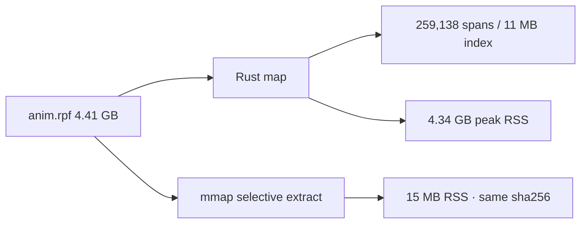

# Large archive pilot

The remaining Downloads archives are too large for the current Rust
`fs::read()` path. The pilot on `anim.rpf` separates the two concerns:
selective extraction is already bounded; full-range indexing still needs a
streaming scanner.

## Pilot result

| Path | Bytes | Peak RSS | Wall |
| --- | ---: | ---: | ---: |
| Rust `map` | 4,407,626,384 | 4.34 GB | 3m49s |
| mmap selective `0x6000..0x62dc` | 2,808 | 15 MB | 0.0s |
| Rust selective extract | 2,808 | 4.31 GB | 3.69s |

Coverage: 100% of `anim.rpf`; 130,509 zlib ranges and 11,572,883,428 decoded
bytes; 37,742,843 unclassified bytes.

## Streaming follow-up

`tools/stream_index.py` uses a read-only mmap, 64 KiB zlib chunks, and periodic
`madvise`.

| Path | Wall | Peak RSS | zlib | Decoded |
| --- | ---: | ---: | ---: | ---: |
| Rust `map` | 3m49s | 4.34 GB | 130,509 | 11,572,883,428 |
| stream_index | 29.08s | 333 MB | 130,510 | 11,593,461,732 |

The extra stream at `0xed61e010..0xee4ff55f` decodes 20,578,304 bytes and is
missed by Rust because `MAX_PAYLOAD_SIZE` is 16 MiB.

## Indexed large archives

| Archive | Stored | zlib | Decoded | >16 MiB | Wall | Peak RSS |
| --- | ---: | ---: | ---: | ---: | ---: | ---: |
| anim | 4.41 GB | 130,510 | 11.59 GB | 1 | 29s | 333 MB |
| packs | 4.80 GB | 144,366 | 9.74 GB | 4 | 36s | 926 MB |
| navmeshes | 6.71 GB | 90,305 | 20.55 GB | 0 | 59s | 782 MB |
| core_bvh4 | 8.30 GB | 565,596 | 129.93 GB | 38 | 317s | 363 MB |
| movies | 8.83 GB | 0 | 0 | 0 | 18s | 8.11 GB |
| story000 | 20.02 GB | 141,163 | 13.77 GB | 13 | 87s | 8.16 GB |
| audio | 28.54 GB | 838 | 54.1 MB | 0 | 73s | 15.91 GB |
| levels | 76.16 GB | 1,117,857 | 174.94 GB | 40 | 819s | 1.21 GB |

Totals: **2,190,635 zlib streams / 360,572,388,767 decoded bytes**. The Rust
16 MiB cap would lose 96 streams; the streaming index is the source of truth.

## Full output rebuild

On 2026-11-21 `output/` was deleted and rebuilt from the external source tree
with `tools/export_all.sh`. All six extracted archives have zero missing, extra,
or failed streams:

| Archive | Streams | Decoded | Status |
| --- | ---: | ---: | --- |
| anim | 130,510 | 11.59 GB | PASS |
| packs | 144,366 | 9.74 GB | PASS |
| navmeshes | 90,305 | 20.55 GB | PASS |
| core_bvh4 | 565,596 | 129.93 GB | PASS |
| story000 | 141,163 | 13.77 GB | PASS |
| audio | 838 | 54.1 MB | PASS |

`levels` and `movies` are index-only. `levels` decodes to 174.9 GB, so extract
it only after moving the output set to the external volume. The complete
verification log is `output/verification.tsv`; the source archives stay on the
external volume.

## Blocker

`src/main.rs` reads the whole archive. `tools/stream_index.py` now indexes all
eight remaining archives; `tools/mmap_extract.py` provides bounded selective
extraction. The Rust 16 MiB payload cap still loses 96 streams and must be
raised or made streaming.

## Order

`anim` → `packs` → `navmeshes` → `core_bvh4` → `movies` → `story000` →
`audio` → `levels`.
