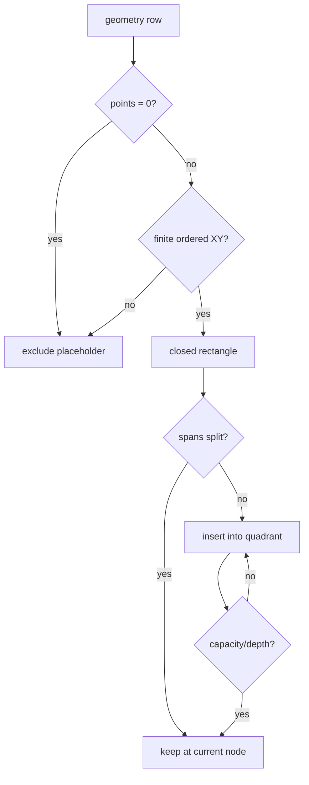
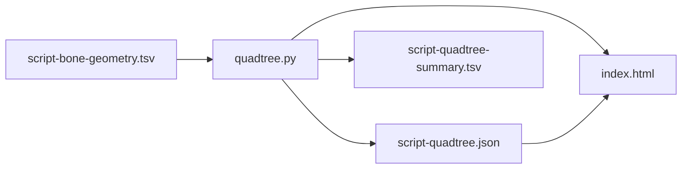

# Quadtree view

The quadtree is a **resource-local** view of decoded class-0 bone bounds. It is
not a world map and it does not infer positions for records without geometry.

## Contract

- one tree per class-0 `root_id`;
- item key `(root_id, table_record, bone_index)`;
- closed rectangle `[min_x, min_y, max_x, max_y]`;
- split-spanning items stay at the current node;
- points on a split choose one side consistently;
- exclude 36 `points=0` placeholder rows;
- keep 412 flat XY extents (lines/points) as spatial items.

## Build decision



## Current view

| Metric | Value |
| --- | ---: |
| roots | 44 |
| valid XY items | 3,007 |
| excluded placeholders | 36 |
| flat XY extents | 412 |

```bash
python3 tools/quadtree.py
# JSON + HTML under output/script-quadtree/
```

The local view is `output/script-quadtree/index.html`; the tracked summary is
`handoff/script-quadtree-summary.tsv` (root, items, nodes, max depth, bounds).
`python3 tools/verify_quadtree.py` checks 44 roots, 3,007 unique items, 36
excluded placeholders, 412 flat extents, no duplicates, no missing/extra items,
and no structural failures. Result: `handoff/script-quadtree-verification.tsv`.



!!! note "Model-local coordinates"
    Bounds come from decoded model space. The tree supports spatial selection
    within one resource; it does not place resources in a common world.
