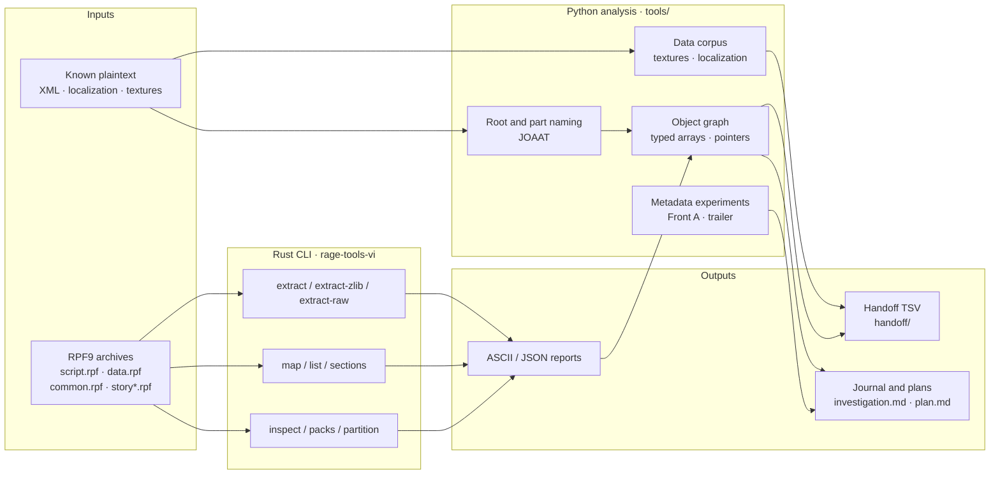
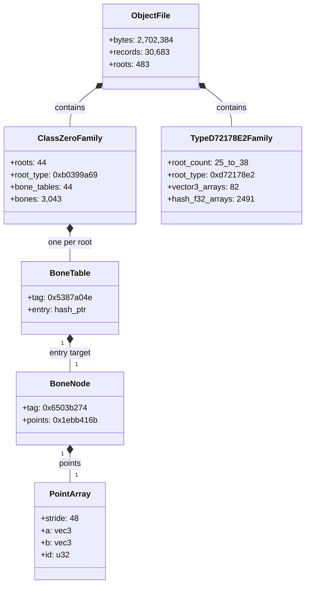

# Rage Tools VI

Reverse engineering of **GTA VI / Leonida RPF9 archives**, with the long-term
goal of enumerating every stored entry and decoding the bytes behind it.

!!! info "Documentation map"
    This site is the navigable model of the project. The append-only research
    record is `investigation.md` and the live check/todo list is `plan.md` at
    the repository root. The diagrams below are the UML/system view that ties those
    files together.

## First milestone — met

> One decoded record independently predicts the exact byte range of a payload
> that has already been checksum-verified.

The `core_bvh4` descriptor is that record. A decoded 208-byte descriptor carries
the entry's exact payload size at `+0xa0`, pairs with the immediately following
stream, and that stream's decoded bytes beyond the declared size are zero —
verified on 260 re-decoded samples. Applied across the archive, it yields
**188,298 entries** across 14 archives, whose boundaries are payload-derived and
whose count matches the declared index in **1,253 of 1,261** `core_bvh4` packs.

New here? Start with **[From first principles](explained.md)**. The result list
is in [Findings](findings.md).

## System at a glance



## Current verified metrics

| Area | Value | State |
| --- | ---: | --- |
| Corpus index | 22 archives · 4,415,868 ranges · 365.0 GB decoded | tiles exactly |
| Bulk extraction | 2,190,635 zlib ranges | SHA-256 verified |
| Entry manifests | 188,298 entries · 14 archives | exact declared-count verification |
| `core_bvh4` descriptors | 269,106 rows | sizes + orthonormal basis |
| Unclassified layer | 38.1 GB audio · 13.4 GB video | closed: all media |
| Audio (`audio.rpf`) | **93,344 Opus · 1,818 XMA2 · 73 ACE1** | zero failures; every stream reaches its declared length |
| Cutscene audio (`story000`) | 196,350 Opus streams · 148.3 hours | decoded, sampled clean |
| Script object | 2,702,384 bytes, 42 zlib streams | checksum verified |
| Object records | 30,683 records, 483 roots | graph enumerated |
| Named script roots | 306 / 483 | JOAAT matched |
| Hash→name registry | **36,952 names** | one table, confidence-ordered, collisions flagged |
| Bone-table hashes | 99 / 612 named | JOAAT of `skel_`/`mh_`/`rb_` |
| Weight hashes | 21 / 252 named | same namespace |
| Decoded rig | 34 / 34 bones | `handoff/script-skeleton-0x48dcbb01.tsv` |
| Skeleton families | 16 | readings: hand, genital, large animal, props |
| Textures | 788 textures / 306,008,064 bytes | descriptor-valid |
| Script schema | `PSIN` ≈18,637 records in 10 archives; **property array only in `script.rpf`** (63,288 typed rows); `LSNS` 58,697 records | parsed; names partly recovered |
| Front A / Front B / trailer | size laws + buffer A arena layout | read verbatim by the loader; section roles open |

## Two object families



## Start here

<div class="grid cards" markdown>

- :material-sitemap: **[Architecture overview](architecture/overview.md)**
  Components, boundaries, and data flow.
- :material-code-braces: **[Rust CLI](architecture/cli.md)**
  Report structs, command dispatch, and extraction sequence.
- :material-graph: **[Object graph](architecture/object-graph.md)**
  Records, pointers, typed arrays, and the class-0 bone hierarchy.
- :material-school: **[From first principles](explained.md)**
  The whole story from zero: what the bytes are, how they are read, why it works.
- :material-magnify: **[Findings](findings.md)**
  The verified results in one page, with proof pointers.
- :material-archive: **[RPF9 format](rpf9/format.md)**
  Header words, spans, zlib chains, and the metadata wall.
- :material-format-list-bulleted: **[Entry manifests](extraction/entries.md)**
  Payload-derived entries, units, coverage, and verification.
- :material-database: **[data.rpf](data/data-rpf.md)**
  Corpus layout, localization, textures, and named resources.

</div>

## Repository conventions

- Offsets are absolute archive offsets.
- Ranges are start-inclusive and end-exclusive.
- `*.rpf` samples and `output/` are local and untracked.
- `plan.md` is the live check/todo list; `investigation.md` is the append-only
  research record.
- Handoff artifacts live under `handoff/`.

```bash
# Build this site
python3 -m venv /tmp/mkdocs-venv
/tmp/mkdocs-venv/bin/pip install -r requirements-docs.txt
/tmp/mkdocs-venv/bin/mkdocs serve
```

## Sibling: the GPU layer

The archive work stops at stored bytes. What the GPU does with them is a
separate project, kept in its own repository and included here as a submodule:

| Path | What it does |
| --- | --- |
| `rdna2-spirv/` | Generic AMD RDNA2 (GFX10.x) decompiler — machine code to SPIR-V, with decoder agreement against LLVM, golden buffer tests, and exact pixel tests on a software Vulkan backend |

Its method, evidence, and open gaps are recorded there, in its own `plan.md` and
`investigation.md`. Clone with `--recurse-submodules` to get it.
