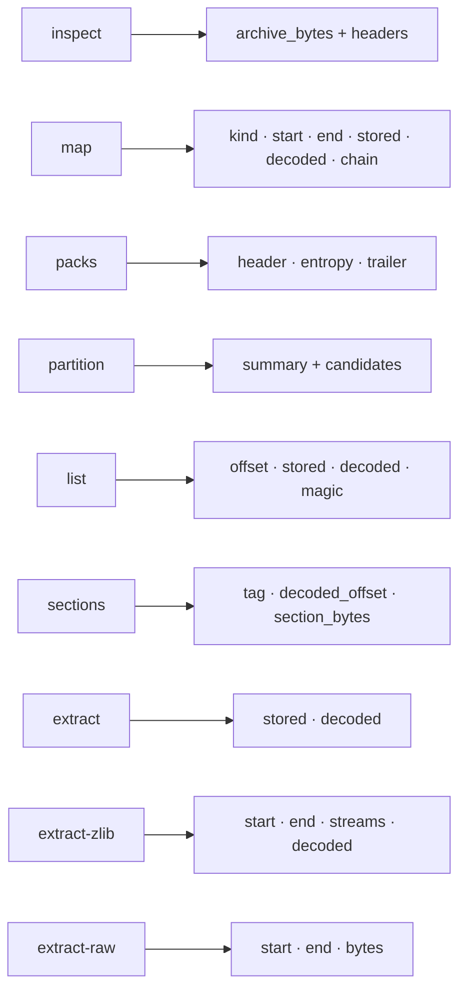
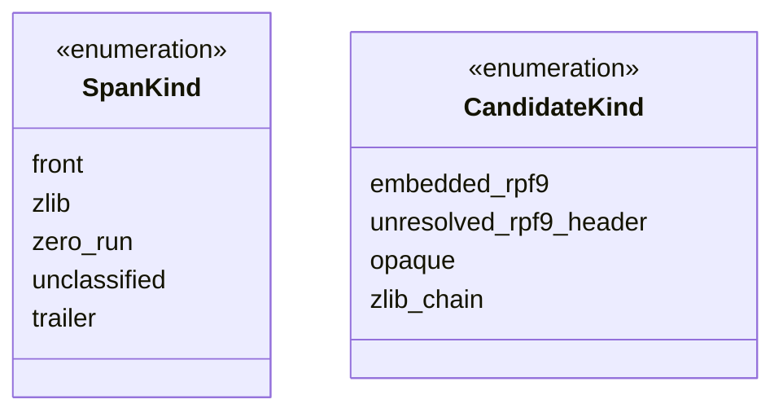

# Report formats

Every CLI report is ASCII/UTF-8 TSV on stdout, or the same data as JSON. Errors
are one plain-text line on stderr with exit status 1; no report is written.

## Contract

| Rule | Value |
| --- | --- |
| delimiter | single tab |
| record separator | single LF |
| quoting | none |
| offsets | absolute, lowercase hex with `0x` |
| ranges | start-inclusive, end-exclusive |
| empty field | not applicable |
| extraction output | create-new; refuse overwrite |

## Commands and shapes

## Span kinds

`zlib` rows carry `decoded_bytes` and `chain_start`; all other span kinds leave
them empty. `unresolved_rpf9_header` carries only `start`.

## JSON

The canonical Serde definitions and examples live in `format.md` at the
repository root and are mirrored in [Source documents](source-format.md). The
CLI report structs are drawn in [Rust CLI](../architecture/cli.md).

!!! note "Status before parse"
    Callers must inspect the process status before parsing stdout. Errors are
    not JSON.
