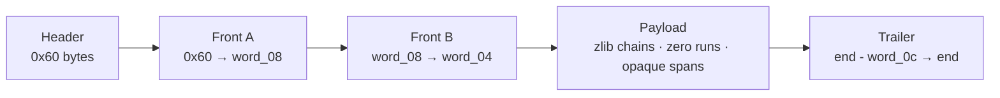
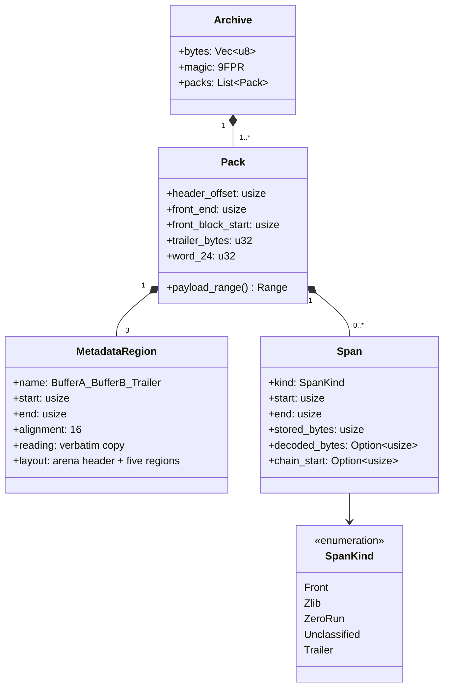
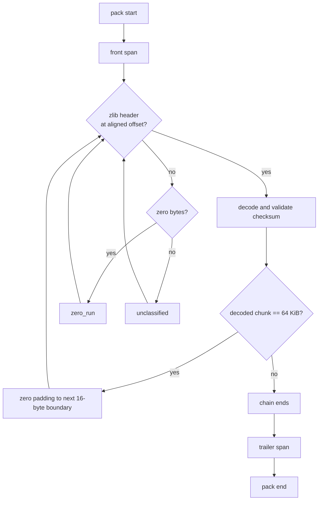
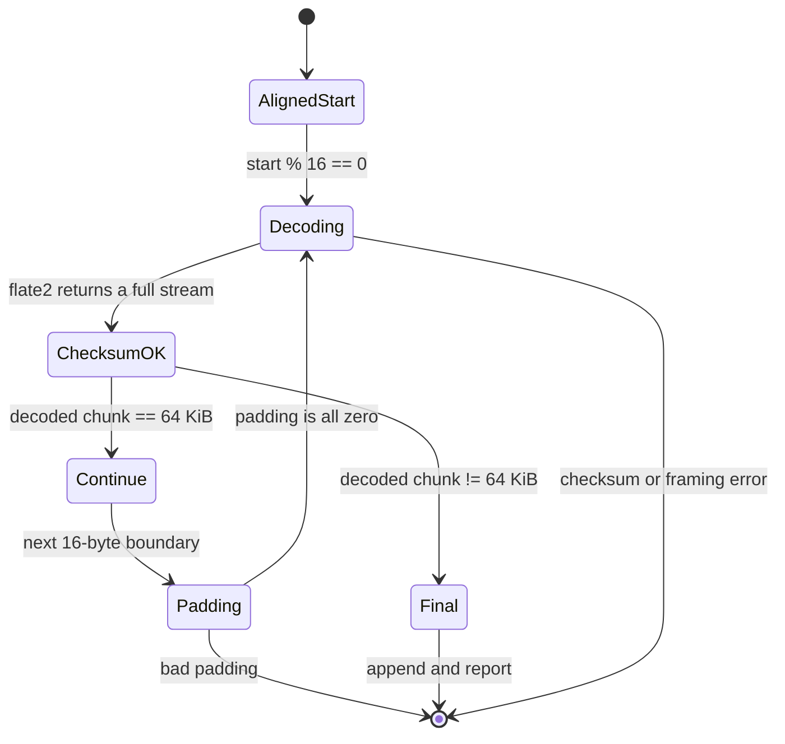
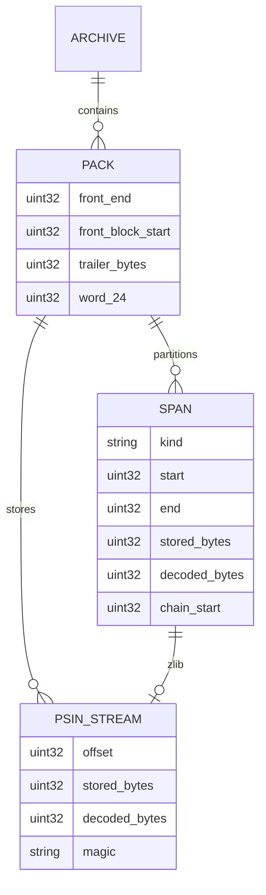

# RPF9 container format

The observed archive begins with the little-endian magic bytes `9FPR` (the
ASCII spelling `RPF9` is used throughout the code). The observed first header is
`0x60` bytes. The code validates at least the first `0x40` bytes for payload
operations. A pack has three metadata regions and a payload region.

## Byte layout

All four boundaries are 16-byte aligned in the observed samples. The header
stores **absolute archive offsets**:

| Word | Offset | Role | Evidence |
| --- | ---: | --- | --- |
| `word_04` | `+0x04` | `front_end` | end of Front B |
| `word_08` | `+0x08` | Front A/B boundary | `align16(9N)`/`align16(10N)` from it in mode family 1 |
| `word_0c` | `+0x0c` | trailer byte length | equals the trailer length in 4,373/4,373 headers |
| `word_24` | `+0x24` | entry count N | Front B law fits every family-1 header |
| `word_2c` | `+0x2c` | entry format tag | 2 values, split at N = 255/256 |
| `word_34..3c` | `+0x34..+0x3c` | zero | constant |
| shared | `+0x40..+0x4c` | 16-byte constant block | identical across all 4,373 headers |
| profile | `+0x50..+0x5c` | profile block | 4 values |

Full word map, size laws, and masking evidence: [Metadata regions](metadata.md).

## UML view of a pack

## Span accounting

`map` partitions the pack range in ascending order without gaps or overlaps.
A fresh zlib chain has `chain_start == start`; a continuation keeps the first
stream's `chain_start`.

## Extraction state machine

## Archive → pack → stream

## Metadata status

Front A, Front B, and the trailer are **not decoded**. They are 16-byte
multiples, the trailer behaves CBC-like, and the size tables are measured. No
key or plaintext name is recovered. See [Metadata regions](metadata.md) for the
negative results and the exact wall.
