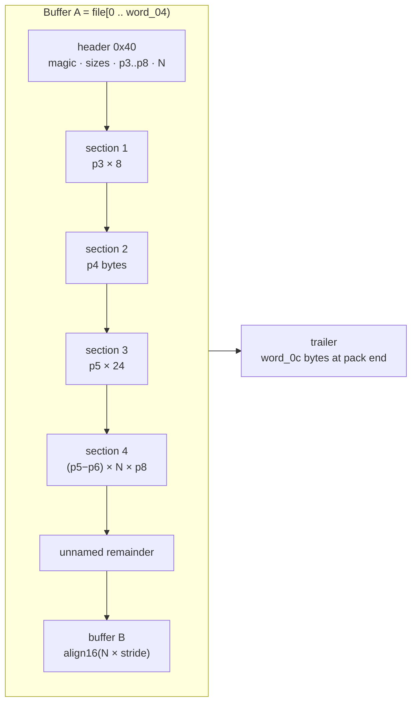

# Pack layout, drawn

Two real packs, mapped from their own headers with the loader's formula. Every
number below is reproducible with `tools/pack_layout.py`.

## `data.rpf+0` — 699 entries

```
mode 0x00010007   N=699   p3=4  p4=336  p5=7  p6=1  p8=2
word_04 = 0x11060   word_08 = 0xf510   trailer = 0x5870

0x00000  0x00040       64  header (magic, sizes, arena fields, entry count)
0x00040  0x00060       32  section 1   4 × 8-byte records
0x00060  0x001b0      336  section 2   raw bytes
0x001b0  0x00260      176  section 3   7 × 24-byte records
0x00260  0x02328     8392  section 4   (7−1) × 699 × 2
0x02328  0x11060    60728  unnamed remainder — buffer B is its last 6,992 bytes
```

## `anim.rpf+0x94c000` — 3 entries

```
mode 0x00010005   N=3   p3=4  p4=336  p5=5  p6=1  p8=1
word_04 = 0x300   word_08 = 0x2e0   trailer = 0x90

0x000  0x040    64  header
0x040  0x060    32  section 1   4 × 8-byte records
0x060  0x1b0   336  section 2   raw bytes
0x1b0  0x230   128  section 3   5 × 24-byte records
0x230  0x240    16  section 4   (5−1) × 3 × 1
0x240  0x300   192  unnamed remainder
```

## What the same two packs say about buffer B

| pack | `word_08 .. word_04` | per entry |
| --- | ---: | ---: |
| `data.rpf+0` | 6,992 B | 10.00 |
| `anim.rpf+0x94c000` | 32 B | 10.67 |

Both are `align16(N × stride)` with stride 10 — the 0.67 is the 16-byte rounding
on a 3-entry pack (`3 × 10 = 30 → 32`). The census over 4,373 headers fixes the
stride at 9 or 10 depending on the `+0x2c` tag.

**Buffer B is not a separate region.** The loader allocates `malloc(word_04)` for
the whole front region and, in its second mode, a second allocation for
`word_08 .. word_04` — a *suffix* of the first. So the entry table lives inside
buffer A, at its end.

## A whole pack, from the file's point of view

`data.rpf` pack 0, with `pack_end` taken from the next header (the last pack ends
at the file size):

```
0x00000            header 0x40
0x00040 .. 0x11060 front region (buffer A; buffer B is its last 6,992 bytes)
0x11060 .. 0x68a790 payload window   6,788,912 bytes
0x68a790 .. 0x690000 trailer            22,640 bytes  (word_0c)
0x690000           next pack
```

The window is not a guess: measuring the **union** of the index ranges clipped to
it gives 100 % coverage for every pack in every archive (`tools/pack_extent_check.py`).

One nuance, measured: 32 ranges cross a pack boundary and **all of them are
`unclassified`** — 18 in `data.rpf`, 12 in `textures.rpf`, 2 in `script.rpf`. No
classified payload (zlib, audio, zero-run, chain) ever crosses, which is what the
model predicts: two packs are independent archives. The opaque spans are the
partitioner's residual and simply do not know where a pack ends.


## The shape in one picture



## What is known, and what is not

| Part | Known | Unknown |
| --- | --- | --- |
| header | every field, from the binary | — |
| sections 1–4 | sizes, exactly | what they contain |
| remainder | it exists, and B sits inside it | its structure; in 79 packs it is exactly `N × 64` |
| buffer B | `align16(N × stride)`, stride 9 or 10 | the record layout |
| trailer | length field matches 4,373/4,373 | content |

The honest one-line summary: **the container is solved, the records inside it are
not.** Sizes everywhere are code-derived or exact; contents are unidentified, and
no 32-bit or 64-bit hash of any known name appears in them.

## Reproduce

```sh
python3 tools/pack_layout.py data.rpf --offset 0
python3 tools/pack_layout.py "$SRC/anim.rpf" --offset 0x94c000
python3 tools/pack_layout.py "$SRC/levels.rpf" --scan 5
```

`tools/pack_layout.py` also prints a warning if the arena overruns the buffer; it
does not for any of the 654 headers in the mirror.
