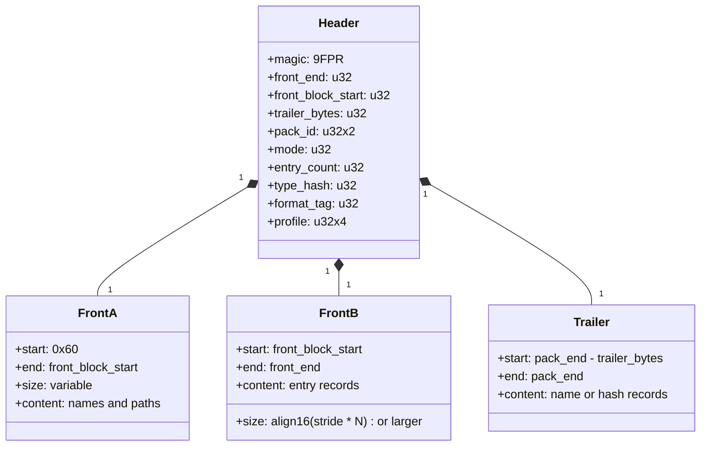
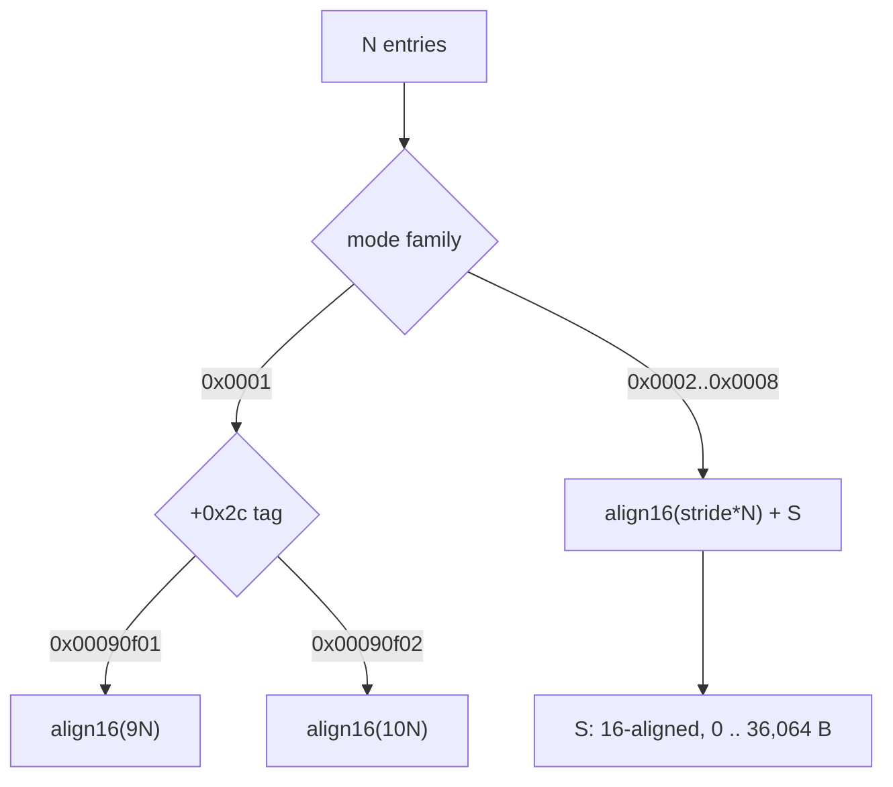
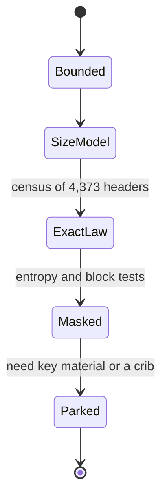

# Metadata regions

The metadata wall is the boundary between “the archive can be partitioned” and
“the archive index can be decoded.”

The region sizes are modelled from the entry count, and the *reading* model is now
taken from the executable rather than inferred: the loader copies the region
verbatim and then interprets it through a 0x40-byte header that declares four
sections. That changed the question from "what is the cipher" to "what are the
four sections", and the census numbers below are retained because they still
describe the bytes on disk.

The sizes and invariants below come from a census of **4,373 RPF9 headers**
across the 22-archive source tree (`handoff/header-census-full.tsv`,
`handoff/header-words.tsv`).

## Region contract



| Region | Bounds | Observed property | Status |
| --- | --- | --- | --- |
| Buffer A | `0x00 .. word_04` | copied verbatim into `malloc(word_04)`; first 16 bytes are the header | read straight from the stream |
| Buffer B | `word_08 .. word_04` | the **tail of buffer A**, re-read into its own allocation | read straight from the stream |
| Trailer | `end - word_0c .. end` | `word_0c` equals the trailer length in all 4,373 headers | unidentified |

## What the binary does

Two functions settle the reading model (`FUN_141fb2600`, `FUN_14087aff0` in the
analysed database):

```
read(stream, 0, .., buf16, 0x10)
if u32(buf16) == '9FPR':
    size = header[+4]                      ; or header[+8] in the second mode
    buf  = malloc(size)
    *buf = buf16 ; buf[1] = buf16[1]       ; the 16 header bytes are copied in
    read(stream, 0x10, buf + 0x10, size - 0x10)
    if mode == 1:
        size_b = header[+4] - header[+8]
        buf2   = malloc(size_b)
        read(stream, header[+8], buf2, size_b)
```

So both metadata buffers are **plain copies of stream bytes**, and the second one
is not a separate region: it is `file[word_08 .. word_04)`, which is the *tail* of
the first buffer. There is no decryption call on this path.

Buffer A then starts with a 0x40-byte header whose fields drive an arena layout of
four sections:

```
p3 = u16 @ 0x1a     p6 = u16 @ 0x22
p4 = u32 @ 0x1c     p7 = u32 @ 0x24   (the entry count N)
p5 = u16 @ 0x20     p8 = u8  @ 0x2c   (1 or 2)

out[1] = align(base + 0x40)
out[2] = align(out[1] + p3*8)                 ; p3 records of 8 bytes
out[3] = align(out[2] + p4)                   ; p4 bytes
out[4] = align(out[3] + p5*0x18)              ; p5 records of 24 bytes
out[5] = align8(out[4] + (p5-p6)*p7*p8)       ; (p5-p6) * N * p8 bytes
```

For `data.rpf+0`: `p3=4, p4=336, p5=7, p6=1, p7=699, p8=2` — sections at
`0x40..0x60`, `0x60..0x1b0`, `0x1b0..0x260`, `0x260..0x2328`. Everything from
`0x2328` to the end of the buffer is *not* covered by the formula, so a fifth,
variable region exists that the traced functions do not size.

This also explains a coincidence that misled the earlier write-up: "Front A starts
at `0x60`" is true only for packs whose first section happens to be 32 bytes.

## Front B size model

Front B is a fixed-stride entry table. For every header in mode family
`0x0001` (2,908 of 4,373) the size is exactly `align16(stride * N)`, where the
stride is selected by the `+0x2c` tag:

| `+0x2c` | Headers | Stride | Exact fits |
| --- | ---: | ---: | ---: |
| `0x00090f01` | 2,414 | 9 bytes | 2,414 / 2,414 |
| `0x00090f02` | 494 | 10 bytes | 494 / 494 |

The tag is a **count-driven format tag**, not a build version: `0x00090f01`
covers N = 1…254 and `0x00090f02` covers N = 257…27,172, with no overlap and no
header at N = 255 or 256.

Because the law is `align16(10N)` exactly, the extra byte is **inside every
record**, not a per-pack header byte (that would give `align16(9N + c)`). A
per-record index running 0…N−1 fits a `u8` up to N = 256 and forces the flip at
N = 257; a per-record count running 1…N forces it at N = 256. Both readings
survive because this build has no pack at either count.

Mode families `0x0002`–`0x0008` add a 16-byte-aligned extra table
`S = Front B − align16(stride * N)`. `S` is 0 for the smallest family-2 packs and
grows to 36,064 bytes; family 4 is the tightest at 224 bytes per entry (±8),
which points at a fixed-size per-entry descriptor. The localization cohort is
the special case `S = 2N + 12`, which is why it also fits `12N + 12` and cannot
distinguish the two readings on its own.



## Entropy census (what the bytes look like)

For each header, the plug-in byte entropy of Front B was compared with the
expected entropy of a uniform random sample of the same length (Monte Carlo
below 1,000 bytes). The deficit is median 0.000, p75 0.009, max 0.357; only 64
of 4,373 regions exceed 0.15, and all are 16–80-byte samples where the
statistic is coarse. All 4,373 first and all 4,373 last 16-byte blocks are
distinct.

No pack in the corpus has a Front B table whose bytes look structured. That is a
statement about *appearance*: the loader copies these bytes verbatim, so if a
transform exists it is inside the stream's `Read` (`+0x60`), which is the one link
in the chain not yet read. Uniform bytes are equally consistent with a dense pool
of 64/128-bit hashes, which is why the entropy test alone cannot decide it — the
64-bit name-hash test in `investigation.md` is the sharper negative.

Cross-pack comparison is unavailable: across the thirteen `data.rpf`
localization packs, which share N = 1,115 and a byte-identical 29,856-byte
trailer, **0 of 13,392 Front B offsets are stable** and byte agreement is at
chance (`tools/front_b_stability.py`). The trailer chain is pack-independent;
the Front B chain is not, or its plaintext is pack-specific in every record.

## Header word map

| Offset | Role | Evidence |
| --- | --- | --- |
| `+0x00` | magic `9FPR` | constant |
| `+0x04` | size of buffer A | the loader passes it to `malloc` |
| `+0x08` | start offset of buffer B | the loader reads `word_04 - word_08` bytes there |
| `+0x0c` | trailer byte length | equals the trailer length in 4,373/4,373 |
| `+0x10`, `+0x14` | per-pack id or salt | unique per header |
| `+0x18` | `(k << 16) \| 0x7a00` | `k` in {4,5,6,7,8}, tracks the mode family |
| `+0x1a` | arena `p3`: count of 8-byte records | from `FUN_14087aff0` |
| `+0x1c` | arena `p4`: byte length of section 2 | from `FUN_14087aff0` |
| `+0x20` | arena `p5`: count of 24-byte records; also `[u16 family][u16 format]` | 19 values |
| `+0x22` | arena `p6`: subtracted from `p5` | from `FUN_14087aff0` |
| `+0x24` | entry count N (`p7`) | the Front B law and the arena both use it |
| `+0x28` | type hash | 10 values, concentrated by mode |
| `+0x2c` | `p8`: 1 or 2, the per-entry multiplier | 2 values, split exactly at N = 255/256 |
| `+0x2d` | flags, bit 0 selects 16-byte instead of 4-byte section alignment | from `FUN_14087aff0` |
| `+0x30` | `+0x1c − 0x140` | 4,306/4,373, exceptions are the `k = 6` group |
| `+0x34`, `+0x38`, `+0x3c` | zero | always zero |
| `+0x40..+0x4c` | constant 16-byte block | one value across all headers |
| `+0x50..+0x5c` | profile block | 4 values (2,906 / 1,398 / 67 / 2) |

The thirteen `data.rpf` localization packs share a byte-identical 29,856-byte
trailer and a single profile, but all thirteen buffer B bodies differ. Whatever the
explanation, one of the two regions is language-independent and the other is not; the
traced loader copies both verbatim, so any transform would sit in the stream's `Read`,
which has not been read.

## Evidence state



!!! warning "Do not scan blindly"
    The size model is closed for mode family 1, and the layout of buffer A is now
    code-derived. What remains is to name the four sections and the fifth,
    unsized region, and to read the stream's `Read` at `+0x60` — the only place a
    transform could still live.

## Reproduce

```sh
python3 tools/header_census.py /path/to/*.rpf --tsv handoff/header-census-full.tsv
python3 tools/front_b_law_fit.py --census handoff/header-census-full.tsv
python3 tools/header_words.py --dump handoff/header-words.tsv
python3 tools/metadata_entropy.py --region b --threshold 0.15
```
