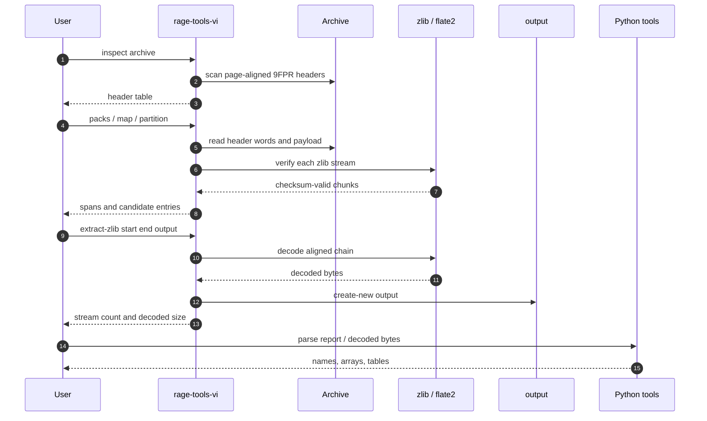
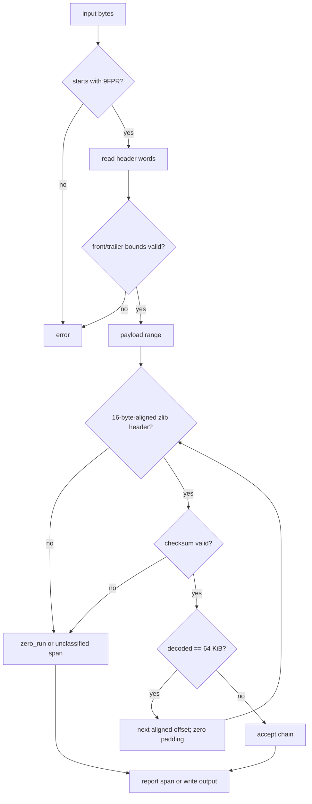
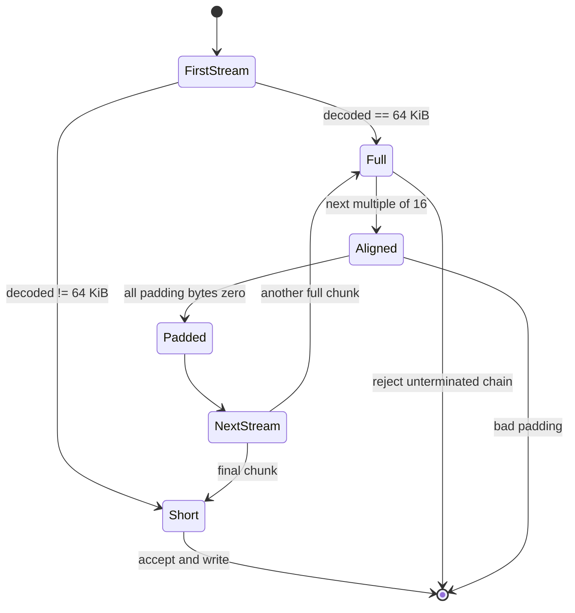
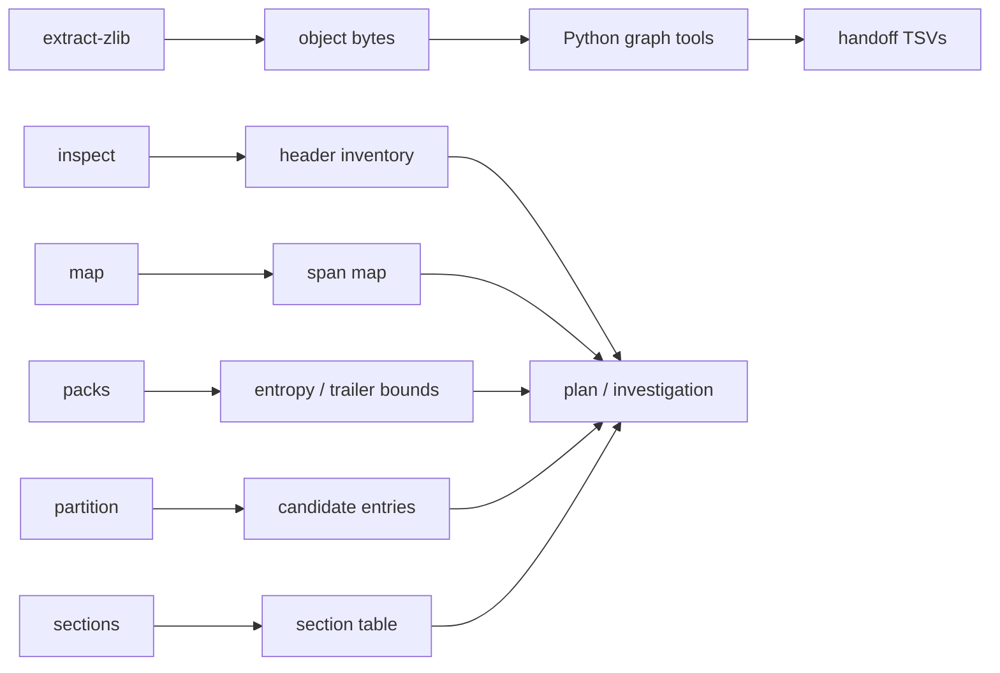

# Extraction pipeline

This is the operational path from an RPF9 file to a report, a decoded stream, or
a verified payload. The Rust CLI owns the byte-level gates; Python analysis
consumes the results.

## End-to-end sequence



## Gate order



## Continuation rule

A stream continues only when:

1. the first decoded chunk is exactly `64 KiB`;
2. the next stream starts at the next 16-byte boundary after the previous
   stored stream;
3. every byte in the intervening padding is zero;
4. the final PSIN continuation has a valid `CHKS` section whose length matches
   the decoded total.



## Report → artifact



## CLI examples

```bash
# Header inventory
target/debug/rage-tools-vi inspect script.rpf

# Partition and report the count comparison
target/debug/rage-tools-vi partition script.rpf

# Decode the 42-stream object
target/debug/rage-tools-vi extract-zlib \
  script.rpf 0x53000 0xc3b45 /tmp/object.bin

# Copy the parked blob literally
target/debug/rage-tools-vi extract-raw \
  script.rpf 0x2010 0x52fe0 /tmp/blob.bin
```

!!! note "Exclusive ends and absolute offsets"
    Every `start..end` range is start-inclusive, end-exclusive, and absolute.
    Extraction refuses to overwrite an existing output path.
